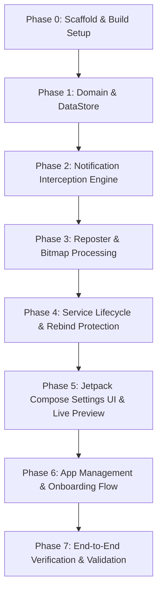

# Implementation Plan: Android Notification Restyler

## 1. Executive Summary & Architectural Overview

The **Android Notification Restyler** is an on-device Android application (API 26–34+) built with Kotlin, Jetpack Compose, and Jetpack DataStore without third-party DI frameworks or relational databases. It has zero network permissions.

The app uses `NotificationListenerService` to intercept incoming notifications from target applications, immediately cancels the original notification, and posts a restyled replacement through `NotificationCompat` with user-configured accents, density, and icon aesthetics while preserving tap targets, timestamps, and inline replies (`RemoteInput`).

```
┌────────────────────────────────────────────────────────────────────────┐
│                          System Notification Shade                     │
└───────────────────▲───────────────────────────────────────┬────────────┘
                    │                                       │
     (1) Posts Original Notification                        │ (3) cancelNotification(key)
                    │                                       │ (4) Repost restyled replacement
┌───────────────────┴───────────────────┐       ┌───────────▼────────────┐
│              Source App               │       │ RestylerNotification-  │
│   (e.g., WhatsApp, Gmail, Slack)      │       │     ListenerService    │
└───────────────────────────────────────┘       └───────────┬────────────┘
                                                            │
                                                Reads User Preferences
                                                            │
                                                ┌───────────▼────────────┐
                                                │   SettingsRepository   │
                                                │  (PreferencesDataStore)│
                                                └───────────▲────────────┘
                                                            │
                                                Configured by User
                                                            │
                                                ┌───────────┴────────────┐
                                                │     MainActivity       │
                                                │ (Jetpack Compose UI)   │
                                                └────────────────────────┘
```

---

## 2. Technical Stack & Toolchain Constraints

| Layer | Specification | Details / Rationale |
| :--- | :--- | :--- |
| **Language** | Kotlin 2.0.0 | Pure Kotlin DSL, strong type safety. |
| **Android SDK** | `compileSdk = 34`, `minSdk = 26`, `targetSdk = 34` | minSdk 26 covers Notification Channels (Oreo+) & Modern NotificationListener APIs. |
| **Build System** | Gradle 8.7+ with Android Gradle Plugin (AGP) 8.4.2 | Compatible with JDK 17 (`/usr/lib/jvm/java-17-temurin-jdk`). |
| **UI Framework** | Jetpack Compose (BOM 2024.06.00) + Material 3 | Single-activity Compose architecture. No XML layouts. |
| **State & Storage** | Jetpack Preferences DataStore 1.1.1 | Lightweight, coroutine-based, non-blocking persistent key-value store. |
| **Architecture** | Single-module (`:app`), Layered (UI, Service, Domain/Data) | Explicitly no Dagger/Hilt, no Koin, no Room, no Retrofit. Manual dependency injection. |
| **Security & Privacy** | `android.permission.INTERNET` **excluded** | Complete on-device privacy guarantee. Notification payload data is never logged or written to disk. |

---

## 3. Package & Project Directory Structure

```
notif/
├── build.gradle.kts                      # Root Gradle build script
├── settings.gradle.kts                   # Project settings & plugin repositories
├── gradle.properties                     # JVM args, AndroidX flags, Kotlin flags
├── gradlew & gradlew.bat                 # Gradle wrapper executables
├── gradle/wrapper/
│   └── gradle-wrapper.properties         # Gradle 8.7 distribution
└── app/
    ├── build.gradle.kts                  # Application-level Gradle build script
    ├── proguard-rules.pro                # Proguard rules for release
    └── src/
        ├── main/
        │   ├── AndroidManifest.xml
        │   ├── res/
        │   │   ├── drawable/
        │   │   │   ├── ic_notification_glyph.xml    # Minimalist status bar vector icon
        │   │   │   ├── ic_launcher_foreground.xml
        │   │   │   └── ic_launcher_background.xml
        │   │   ├── mipmap-.../                      # App launcher icons
        │   │   └── values/
        │   │       ├── strings.xml
        │   │       ├── colors.xml
        │   │       └── themes.xml
        │   └── java/com/notif/restyler/
        │       ├── RestylerApplication.kt           # Application class: initializes channels & singleton repo
        │       ├── model/
        │       │   ├── RestylerSettings.kt          # Immutable data class for user styling
        │       │   ├── NotificationDensity.kt       # Enum (COMPACT, COMFORTABLE)
        │       │   ├── IconStyle.kt                 # Enum (APP_ICON, MONOCHROME_APP_ICON, GENERIC_GLYPH)
        │       │   └── AppInfo.kt                   # App metadata (packageName, label, icon, isRestyled)
        │       ├── data/
        │       │   ├── SettingsKeys.kt              # DataStore Preferences keys
        │       │   └── SettingsRepository.kt        # Interface & implementation wrapping DataStore
        │       ├── service/
        │       │   ├── RestylerNotificationListenerService.kt # Notification interception & dispatch
        │       │   ├── NotificationReposter.kt      # Extraction, restyling & posting logic
        │       │   ├── NotificationChannels.kt      # Channel definitions (Alerting & Silent)
        │       │   └── ServiceStateHolder.kt        # Reactive connection state (Flow<Boolean>)
        │       ├── util/
        │       │   ├── BitmapUtils.kt               # Drawable to Bitmap conversion & grayscale tinting
        │       │   └── PermissionUtils.kt           # Checks for Notification Access, Battery Optimization, POST_NOTIFICATIONS
        │       └── ui/
        │           ├── MainActivity.kt              # Activity entrypoint hosting Compose UI
        │           ├── MainViewModel.kt             # UI state holder & business logic coordinator
        │           ├── theme/
        │           │   ├── Color.kt
        │           │   ├── Theme.kt
        │           │   └── Type.kt
        │           └── components/
        │               ├── StatusBanner.kt          # Listener active/rebind status card
        │               ├── LivePreviewCard.kt       # Dynamic notification shade mockup preview
        │               ├── StylingControls.kt       # Color picker, density tabs, icon style radios
        │               ├── AppListSheet.kt          # Per-app whitelist/blacklist toggles
        │               └── OnboardingDialog.kt      # Permission flow & Restricted Settings guidance
        └── test/                                    # Unit tests for settings parsing & filter rules
```

---

## 4. Phase-by-Phase Implementation Blueprint



---

### Phase 0: Project Scaffolding & Build Configuration

#### 0.1 Root Configuration
- **`settings.gradle.kts`**:
  - Configure plugin repositories: `google()`, `mavenCentral()`.
  - Set root project name: `rootProject.name = "notif"`.
  - Include subproject: `include(":app")`.
- **`gradle.properties`**:
  ```properties
  org.gradle.jvmargs=-Xmx2048m -Dfile.encoding=UTF-8
  android.useAndroidX=true
  android.nonTransitiveRClass=true
  kotlin.code.style=official
  ```

#### 0.2 Application Configuration (`app/build.gradle.kts`)
- Plugins:
  - `id("com.android.application")` version `8.4.2`
  - `id("org.jetbrains.kotlin.android")` version `2.0.0`
  - `id("org.jetbrains.kotlin.plugin.compose")` version `2.0.0`
- Android Block:
  - `namespace = "com.notif.restyler"`
  - `compileSdk = 34`
  - `defaultConfig`:
    - `applicationId = "com.notif.restyler"`
    - `minSdk = 26`
    - `targetSdk = 34`
    - `versionCode = 1`
    - `versionName = "1.0.0"`
  - `compileOptions`: Java 17 compatibility (`sourceCompatibility = JavaVersion.VERSION_17`, `targetCompatibility = JavaVersion.VERSION_17`).
  - `kotlinOptions`: `jvmTarget = "17"`.
  - `buildFeatures`: `compose = true`.
- Dependencies:
  - `androidx.core:core-ktx:1.13.1`
  - `androidx.lifecycle:lifecycle-runtime-ktx:2.8.3`
  - `androidx.lifecycle:lifecycle-viewmodel-compose:2.8.3`
  - `androidx.activity:activity-compose:1.9.0`
  - Compose BOM: `platform("androidx.compose:compose-bom:2024.06.00")`
  - Compose libraries: `ui`, `ui-graphics`, `ui-tooling-preview`, `material3`, `material-icons-extended`
  - `androidx.datastore:datastore-preferences:1.1.1`
  - Test dependencies: `junit:junit:4.13.2`, `androidx.test.ext:junit:1.2.1`

#### 0.3 Manifest Configuration (`app/src/main/AndroidManifest.xml`)
- Permissions:
  - `android.permission.POST_NOTIFICATIONS` (API 33+ requirement for posting restyled notifications).
  - `android.permission.REQUEST_IGNORE_BATTERY_OPTIMIZATIONS` (For OEM kill resilience).
  - `android.permission.QUERY_ALL_PACKAGES` (With `tools:ignore="QueryAllPackagesCondition"` to allow enumerating installed apps in settings).
  - **Explicitly omitted:** `android.permission.INTERNET`.
- Application Declaration:
  - `android:name=".RestylerApplication"`
  - `android:icon="@mipmap/ic_launcher"`
  - `android:label="@string/app_name"`
  - `android:theme="@style/Theme.NotificationRestyler"`
- Activity Declaration:
  - `MainActivity`: `exported = true`, `launchMode = "singleTop"`.
  - `<intent-filter>` with `ACTION_MAIN` and `CATEGORY_LAUNCHER`.
- Service Declaration:
  - `RestylerNotificationListenerService`:
    - `android:permission="android.permission.BIND_NOTIFICATION_LISTENER_SERVICE"`
    - `android:exported = true`
    - `<intent-filter>`: `<action android:name="android.service.notification.NotificationListenerService" />`

---

### Phase 1: Domain Models, DataStore & Settings Repository

#### 1.1 Domain Models
Create immutable data representations in `com.notif.restyler.model`:
1. **`NotificationDensity.kt`**:
   ```kotlin
   enum class NotificationDensity {
       COMPACT,     // Single line / collapsed summary, minimum vertical footprint
       COMFORTABLE  // BigTextStyle enabled, multi-line preview, generous spacing
   }
   ```
2. **`IconStyle.kt`**:
   ```kotlin
   enum class IconStyle {
       APP_ICON,             // Original full-color app icon as largeIcon
       MONOCHROME_APP_ICON,  // Grayscale & accent-tinted app icon as largeIcon
       GENERIC_GLYPH         // No largeIcon; only status-bar minimalist glyph
   }
   ```
3. **`RestylerSettings.kt`**:
   ```kotlin
   data class RestylerSettings(
       val accentColorHex: String = "#6750A4", // Default Material 3 Primary Hex
       val density: NotificationDensity = NotificationDensity.COMFORTABLE,
       val iconStyle: IconStyle = IconStyle.APP_ICON,
       val disabledPackages: Set<String> = emptySet(), // Excluded from restyling
       val isServiceEnabled: Boolean = true
   ) {
       val accentColorInt: Int
           get() = try {
               android.graphics.Color.parseColor(accentColorHex)
           } catch (_: Exception) {
               0xFF6750A4.toInt()
           }
   }
   ```
4. **`AppInfo.kt`**:
   ```kotlin
   data class AppInfo(
       val packageName: String,
       val appName: String,
       val icon: android.graphics.drawable.Drawable?,
       val isRestyled: Boolean
   )
   ```

#### 1.2 DataStore Keys & SettingsRepository
- File: `com.notif.restyler.data.SettingsKeys.kt`
  - `KEY_ACCENT_COLOR = stringPreferencesKey("accent_color_hex")`
  - `KEY_DENSITY = stringPreferencesKey("density")`
  - `KEY_ICON_STYLE = stringPreferencesKey("icon_style")`
  - `KEY_DISABLED_PACKAGES = stringSetPreferencesKey("disabled_packages")`
  - `KEY_SERVICE_ENABLED = booleanPreferencesKey("service_enabled")`
- File: `com.notif.restyler.data.SettingsRepository.kt`
  - Provides a single source of truth exposed via Kotlin `StateFlow<RestylerSettings>`.
  - Methods:
    - `val settingsFlow: Flow<RestylerSettings>`
    - `suspend fun getLatestSettings(): RestylerSettings`
    - `suspend fun setAccentColor(hex: String)`
    - `suspend fun setDensity(density: NotificationDensity)`
    - `suspend fun setIconStyle(iconStyle: IconStyle)`
    - `suspend fun toggleAppRestyle(packageName: String, restyle: Boolean)`
    - `suspend fun setServiceEnabled(enabled: Boolean)`
- Initialization:
  - Stored at `Context.dataStore` delegate: `private val Context.dataStore: DataStore<Preferences> by preferencesDataStore(name = "restyler_settings")`.
  - Accessible via `RestylerApplication.instance.settingsRepository`.

---

### Phase 2: Notification Interception Engine & Core Service

#### 2.1 Reactive Service Connection State (`ServiceStateHolder.kt`)
Because `NotificationListenerService` lifecycle is managed strictly by the Android OS System Server, the UI cannot bind to it via standard Android `bindService`.
- Create `ServiceStateHolder`:
  ```kotlin
  object ServiceStateHolder {
      private val _isConnected = MutableStateFlow(false)
      val isConnected: StateFlow<Boolean> = _isConnected.asStateFlow()

      fun setConnected(connected: Boolean) {
          _isConnected.value = connected
      }
  }
  ```

#### 2.2 Notification Channels Initialization (`NotificationChannels.kt`)
On Android 8.0+ (minSdk 26), notifications must be posted to a valid channel. Two dedicated channels will be registered in `RestylerApplication.onCreate()`:
1. **`channel_restyled_alerting`**:
   - Name: "Restyled Notifications"
   - Importance: `NotificationManager.IMPORTANCE_DEFAULT` (or `HIGH` for heads-up if desired)
   - Sound: System default
   - Vibration: Enabled
2. **`channel_restyled_silent`**:
   - Name: "Restyled Notifications (Silent)"
   - Importance: `NotificationManager.IMPORTANCE_LOW`
   - Sound: None
   - Vibration: Disabled

#### 2.3 `RestylerNotificationListenerService.kt`
The listener intercepts, filters, cancels, and forwards notifications.

```kotlin
class RestylerNotificationListenerService : NotificationListenerService() {

    private val serviceScope = CoroutineScope(SupervisorJob() + Dispatchers.Default)
    private lateinit var reposter: NotificationReposter
    private lateinit var settingsRepo: SettingsRepository

    override fun onCreate() {
        super.onCreate()
        settingsRepo = (application as RestylerApplication).settingsRepository
        reposter = NotificationReposter(this, settingsRepo)
    }

    override fun onListenerConnected() {
        super.onListenerConnected()
        ServiceStateHolder.setConnected(true)
    }

    override fun onListenerDisconnected() {
        super.onListenerDisconnected()
        ServiceStateHolder.setConnected(false)
    }

    override fun onNotificationPosted(sbn: StatusBarNotification) {
        serviceScope.launch {
            if (shouldSkipNotification(sbn)) return@launch

            // 1. Cancel original notification to prevent duplicate entries
            cancelNotification(sbn.key)

            // 2. Delegate extraction & reposting
            reposter.repostNotification(sbn)
        }
    }

    override fun onNotificationRemoved(sbn: StatusBarNotification) {
        serviceScope.launch {
            if (sbn.packageName == packageName) return@launch
            reposter.removeReplacement(sbn)
        }
    }

    private suspend fun shouldSkipNotification(sbn: StatusBarNotification): Boolean {
        // ... detailed filter logic ...
    }
}
```

#### 2.4 Strict Interception Filter Logic
To avoid loops, UI lockups, or breaking core OS telephony/navigation, the filter implements the following evaluation order:
1. **Self-Loop Check:** `sbn.packageName == packageName` -> **SKIP** (Never restyle our own notifications).
2. **Master Switch Check:** If `settings.isServiceEnabled == false` -> **SKIP**.
3. **Ongoing Notification Check:** `sbn.isOngoing || (sbn.notification.flags and Notification.FLAG_ONGOING_EVENT != 0)` -> **SKIP** (e.g., active foreground services, timer, audio playback).
4. **Group Summary Check:** `(sbn.notification.flags and Notification.FLAG_GROUP_SUMMARY != 0)` -> **SKIP** (System group summaries must not be duplicated).
5. **System Categories Check:**
   Skip if `sbn.notification.category` matches any of:
   - `Notification.CATEGORY_CALL`
   - `Notification.CATEGORY_NAVIGATION`
   - `Notification.CATEGORY_TRANSPORT`
   - `Notification.CATEGORY_PROGRESS`
   - `Notification.CATEGORY_ALARM`
   - `Notification.CATEGORY_SERVICE`
6. **System Package Blacklist:**
   Skip core platform packages:
   - `android`
   - `com.android.systemui`
   - `com.google.android.gms`
   - `com.android.vending` (Google Play Store download/install notifications)
7. **User Per-App Blacklist:**
   If `settings.disabledPackages.contains(sbn.packageName)` -> **SKIP**.

---

### Phase 3: Extraction, Reposting & Graphic Asset Transformation

#### 3.1 Replacement ID & Tag Deterministic Mapping
- Android notifications are uniquely keyed in `NotificationManagerCompat` by `(tag: String?, id: Int)`.
- `StatusBarNotification.key` is formatted as `|pkg|id|tag|uid`.
- To ensure updates from the source app update the replacement in place, we define:
  ```kotlin
  val replacementTag: String = sbn.packageName
  val replacementId: Int = sbn.key.hashCode()
  ```
- When `onNotificationRemoved(sbn)` triggers:
  ```kotlin
  NotificationManagerCompat.from(context).cancel(sbn.packageName, sbn.key.hashCode())
  ```

#### 3.2 Notification Content Extraction Contract
Extract all metadata from `sbn.notification.extras`:
- **Title:** `extras.getCharSequence(Notification.EXTRA_TITLE)?.toString()` fallback to source app label.
- **Text:** `extras.getCharSequence(Notification.EXTRA_TEXT)?.toString() ?: ""`
- **BigText:** `extras.getCharSequence(Notification.EXTRA_BIG_TEXT)?.toString() ?: text`
- **SubText / Summary:** `extras.getCharSequence(Notification.EXTRA_SUB_TEXT)?.toString()`
- **Timestamp:** `if (sbn.notification.`when` > 0) sbn.notification.`when` else System.currentTimeMillis()`
- **ContentIntent:** `sbn.notification.contentIntent` (tap action opening source app).
- **DeleteIntent:** `sbn.notification.deleteIntent` (syncs dismissals back to source app).

#### 3.3 Action Preservation & RemoteInput (Inline Reply)
Preserving inline replies is a core requirement. Modern apps attach `RemoteInput` to actions (e.g. "Reply").
```kotlin
fun mapActions(originalActions: Array<Notification.Action>?, builder: NotificationCompat.Builder) {
    if (originalActions.isNullOrEmpty()) return

    for (action in originalActions) {
        val actionTitle = action.title ?: continue
        val actionIntent = action.actionIntent ?: continue

        val compatActionBuilder = NotificationCompat.Action.Builder(
            0, // Icon omitted or generic to keep unified minimalist style
            actionTitle,
            actionIntent
        )

        // Forward RemoteInputs for inline replies (e.g. WhatsApp, Telegram, Slack)
        action.remoteInputs?.forEach { remoteInput ->
            val compatRemoteInput = androidx.core.app.RemoteInput.Builder(remoteInput.resultKey)
                .setLabel(remoteInput.label)
                .setChoices(remoteInput.choices)
                .setAllowFreeFormInput(remoteInput.allowFreeFormInput)
                .addExtras(remoteInput.extras)
                .build()
            compatActionBuilder.addRemoteInput(compatRemoteInput)
        }

        builder.addAction(compatActionBuilder.build())
    }
}
```

#### 3.4 Icon & Graphic Processing (`BitmapUtils.kt`)
1. **Status Bar Small Icon (`smallIcon`):**
   - Must be a compiled drawable resource ID inside our app: `R.drawable.ic_notification_glyph` (a clean, geometric vector glyph).
   - The foreign app's icon CANNOT be passed as a resource ID to `setSmallIcon()`.
2. **Large Icon (`largeIcon`):**
   - Extracted from `packageManager.getApplicationIcon(sbn.packageName)`.
   - Converted from `Drawable` to `Bitmap` (handling `AdaptiveIconDrawable`, `BitmapDrawable`, and vector drawables safely).
   - Handled according to `settings.iconStyle`:
     - **`APP_ICON`**: Full-color bitmap scaled to standard 48x48dp.
     - **`MONOCHROME_APP_ICON`**: Converted to grayscale via `ColorMatrix(saturation = 0f)`, then tinted or overlaid using `settings.accentColorInt`.
     - **`GENERIC_GLYPH`**: `setLargeIcon(null)` (no large icon in notification body).

#### 3.5 Density & Style Application
- **`NotificationDensity.COMFORTABLE`**:
  ```kotlin
  val style = NotificationCompat.BigTextStyle()
      .bigText(bigText)
      .setBigContentTitle(title)
  if (!subText.isNullOrBlank()) style.setSummaryText(subText)
  builder.setStyle(style)
  ```
- **`NotificationDensity.COMPACT`**:
  ```kotlin
  // Do not set BigTextStyle; clamp to standard single line
  builder.setContentTitle(title)
      .setContentText(text)
  ```
- **Accent Color:**
  ```kotlin
  builder.setColor(settings.accentColorInt)
      .setColorized(false) // Keeps system card background clean while tinting title/badge
  ```
- **Grouping:**
  ```kotlin
  builder.setGroup(sbn.packageName)
  ```

---

### Phase 4: Service Lifecycle, Rebind & OEM Kill Resilience

#### 4.1 OEM Background Killer Mitigation
OEM implementations (MIUI/HyperOS, Samsung One UI, ColorOS) aggressively kill background services and unbind notification listeners.
1. **Active Connection Detection:**
   - In `MainViewModel`, collect `ServiceStateHolder.isConnected`.
   - Also verify via `NotificationManagerCompat.getEnabledListenerPackages(context).contains(context.packageName)`.
2. **Rebind Strategy:**
   - Expose a button to call `NotificationListenerService.requestRebind(ComponentName(context, RestylerNotificationListenerService::class.java))`.
   - Fallback toggle: If rebind fails, programmatically toggle the service component state:
     ```kotlin
     fun forceRebind(context: Context) {
         val component = ComponentName(context, RestylerNotificationListenerService::class.java)
         val pm = context.packageManager
         pm.setComponentEnabledSetting(component, PackageManager.COMPONENT_ENABLED_STATE_DISABLED, PackageManager.DONT_KILL_APP)
         pm.setComponentEnabledSetting(component, PackageManager.COMPONENT_ENABLED_STATE_ENABLED, PackageManager.DONT_KILL_APP)
     }
     ```
3. **Battery Optimization Exemption:**
   - Check `(context.getSystemService(Context.POWER_SERVICE) as PowerManager).isIgnoringBatteryOptimizations(context.packageName)`.
   - Direct user to `Settings.ACTION_REQUEST_IGNORE_BATTERY_OPTIMIZATIONS` with URI `package:$packageName`.

---

### Phase 5: Jetpack Compose Settings UI & Live Preview

#### 5.1 Architecture & State Flow
- `MainViewModel` exposes a unified `MainUiState`:
  ```kotlin
  data class MainUiState(
      val isListenerConnected: Boolean = false,
      val isNotificationAccessGranted: Boolean = false,
      val isBatteryOptimizationIgnored: Boolean = false,
      val isPostNotificationsGranted: Boolean = false,
      val settings: RestylerSettings = RestylerSettings(),
      val installedApps: List<AppInfo> = emptyList(),
      val searchQuery: String = "",
      val isLoadingApps: Boolean = false
  )
  ```

#### 5.2 UI Component Breakdown (`MainActivity.kt`)
1. **Header & Service Status Banner (`StatusBanner.kt`):**
   - Active: Green pill badge "Restyler Active".
   - Disconnected / Not granted: Warning banner with two primary action chips:
     - "Enable Notification Access" -> Launches `Settings.ACTION_NOTIFICATION_LISTENER_SETTINGS`.
     - "Reconnect Service" -> Invokes `forceRebind()`.
     - "Disable Battery Optimizations" -> Launches system battery exemption request.
2. **Live Notification Preview Card (`LivePreviewCard.kt`):**
   - A Compose card rendering an exact replica of the Android system notification card.
   - Shows:
     - Header: App Name ("Sample Messenger"), time ("now"), and `smallIcon` tinted with `accentColor`.
     - Body: Title ("Alex Miller"), text ("Hey, are we still meeting at 6?").
     - Large Icon: App icon / Monochrome icon / None (reflecting `iconStyle`).
     - Layout: Expanded vs Compact (reflecting `density`).
     - Inline Reply action chip with input field simulation.
   - Updates in real-time as the user changes colors, density, or icon modes.
3. **Styling Controls (`StylingControls.kt`):**
   - **Accent Color:**
     - Palette of 6 curated minimalist swatches (Slate, Emerald, Indigo, Amber, Rose, Monochrome Charcoal).
     - Custom Hex input field with live `#RRGGBB` format validation and error indicator.
   - **Density Selector:**
     - Segmented control / SingleChoiceSegmentedButtonRow: `Compact` vs `Comfortable`.
   - **Icon Style Selector:**
     - Segmented radio buttons: `Original App Icon`, `Monochrome Tint`, `Generic Glyph`.
4. **Master Restyle Switch:**
   - Top-level switch to quickly pause/resume all restyling without revoking system permissions.

---

### Phase 6: Per-App Management & Onboarding Flow

#### 6.1 App Enumeration & Querying
- Run on `Dispatchers.IO` in `MainViewModel`:
  ```kotlin
  val pm = context.packageManager
  val packages = pm.getInstalledApplications(PackageManager.GET_META_DATA)
  // Filter out core system apps without launch intents to keep the list clean
  val apps = packages
      .filter { pm.getLaunchIntentForPackage(it.packageName) != null && it.packageName != context.packageName }
      .map { app ->
          AppInfo(
              packageName = app.packageName,
              appName = pm.getApplicationLabel(app).toString(),
              icon = pm.getApplicationIcon(app),
              isRestyled = !settings.disabledPackages.contains(app.packageName)
          )
      }
      .sortedBy { it.appName.lowercase() }
  ```
- Search bar to filter installed apps in real-time by name or package ID.
- Switch per item: toggle `restyle` on/off (stored in DataStore `KEY_DISABLED_PACKAGES`).
- Bulk actions: "Select All" / "Deselect All".

#### 6.2 Android 13+ Permissions & Restricted Settings Guidance
- **`POST_NOTIFICATIONS` Prompt:**
  - Standard `rememberLauncherForActivityResult(ActivityResultContracts.RequestPermission())` invoked on first app launch if `Build.VERSION.SDK_INT >= 33`.
- **Sideloaded APK "Restricted Settings" Handling:**
  - Android 13+ greys out Notification Listener access for sideloaded APKs.
  - An informational card/dialog with visual steps:
    1. Open phone **Settings** -> **Apps** -> **Notification Restyler**.
    2. Tap the **three dots (⋮)** in the top-right corner.
    3. Tap **Allow restricted settings**.
    4. Return to this app and enable Notification Access.

---

### Phase 7: Verification, Test Checklist & Sideloading Runbook

#### 7.1 Automated Unit Tests
- `SettingsRepositoryTest`:
  - DataStore serialization/deserialization for custom hex, density enums, and package sets.
- `NotificationFilterTest`:
  - Verify `shouldSkipNotification` correctly flags own package, ongoing notifications, call/navigation categories, and blacklisted packages.

#### 7.2 Manual Physical Device Test Checklist
- [ ] **Onboarding & Permissions:**
  - Fresh install on Android 13/14 physical device.
  - Verify "Restricted settings" warning appears if sideloaded.
  - Verify permission redirection lands directly on the Notification Access settings page.
  - Verify service shows green "Restyler Active" status badge once enabled.
- [ ] **Basic Restyle:**
  - Send notification from Slack or Telegram.
  - Verify original disappears and restyled notification appears with correct title, text, and timestamp.
  - Verify tapping notification opens the source app directly.
- [ ] **Inline Reply (`RemoteInput`):**
  - Receive a direct message on WhatsApp / Telegram / Signal.
  - Tap "Reply" on the restyled notification, type a reply, and send.
  - Verify message sends successfully without opening the app.
- [ ] **Update-in-Place:**
  - Send an email, then send another email in the same thread.
  - Verify replacement notification updates its body/counter rather than creating a duplicate rogue card.
- [ ] **Dismissal Synchronization:**
  - Swipe away restyled notification; verify original is not re-posted.
  - Dismiss notification inside the source app; verify restyled notification disappears (`onNotificationRemoved`).
- [ ] **Excluded Categories:**
  - Start Google Maps navigation or initiate a phone call.
  - Verify ongoing navigation banner and incoming call HUD are untouched.
- [ ] **Settings Real-Time Update:**
  - Change accent color to Amber and density to Compact in the settings screen.
  - Trigger a new notification; verify the new styling is applied immediately without restarting the service.
- [ ] **Rebind & Kill Recovery:**
  - Force close app process via `adb shell am force-stop com.notif.restyler`.
  - Reopen app; verify service automatically reconnects or reconnects via "Reconnect" button.

---

## 5. Risk Assessment & Mitigations

| Risk / Edge Case | Impact | Mitigation Strategy |
| :--- | :--- | :--- |
| **Notification Loop** | Infinite loop crashes SystemUI or app | Guard clause `sbn.packageName == packageName` evaluated before any processing or cancellation. |
| **Small Icon Crash** | `IllegalArgumentException: Invalid icon` if resource ID is foreign | Hardcode status bar small icon to local vector drawable `R.drawable.ic_notification_glyph`. Never pass foreign resource IDs to `setSmallIcon()`. |
| **Large Icon OOM** | Out-Of-Memory from huge application drawables | Scale all decoded/rendered Bitmaps to standard fixed notification large icon dimensions (max 192x192px). |
| **PendingIntent Trampoline Restriction (Android 12+)** | Notification tap blocked by OS | Directly forward the original `sbn.notification.contentIntent` without wrapping it in an intermediate broadcast receiver or trampoline service. |
| **Double Alert Sound** | Audio chime plays twice (original + restyled) | Clearly document in onboarding that users should set target apps to Silent/Minimise or rely on DND, letting the restyler channel handle alerting. |
| **Sideloaded "Restricted Settings" (API 33+)** | User unable to toggle listener on | Proactively display step-by-step instructions in onboarding dialog guiding the user to "Allow restricted settings" in App Info. |

---

## 6. Definition of Done (v1)

1. **Gradle Build Success:** `./gradlew assembleDebug` completes with 0 errors on JDK 17.
2. **Clean Architecture:** Single module, zero DI frameworks, zero network permissions in manifest.
3. **Functional Verification on Device:**
   - Successfully intercepts, dismisses, and restyles notifications from at least 3 distinct apps (e.g. WhatsApp/Telegram, Gmail, YouTube).
   - Preserves contentIntent (tap to launch) and RemoteInput (inline quick reply).
   - Live settings adjustments (accent color, density, icon style) reflect immediately on subsequent notifications.
4. **Documentation:** Complete `README.md` containing build commands, ADB debugging commands, and the verification checklist.
